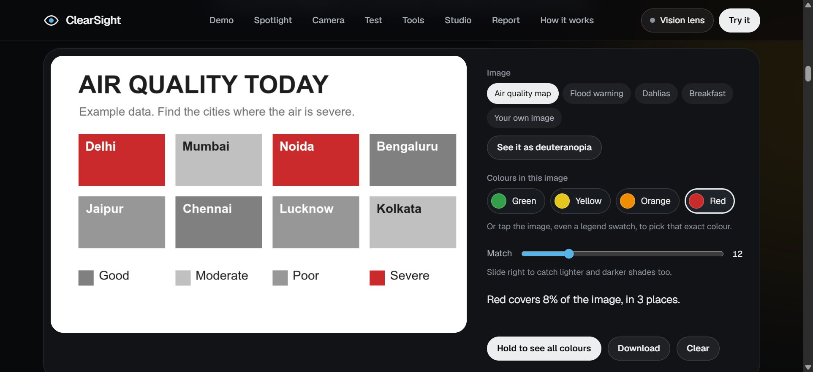

<div align="center">

# ClearSight

**See what everyone sees.**

One public notice in. A full accessibility pack out: colour-blind-safe, low-vision, low-data and print-ready versions in seconds, powered by [Cloudinary](https://cloudinary.com).

[**Live demo →**](https://resplendent-maamoul-58cc39.netlify.app) &nbsp;·&nbsp; [Project write-up](docs/NOTION.md) &nbsp;·&nbsp; [Complete guide](docs/GUIDE.md) &nbsp;·&nbsp; Designed and built by [Bhavishya Sharma](https://github.com/Sharmabhavishya)


</div>

---

## The problem

Flood maps, vaccination posters, heatwave advisories and school notices are usually published as **one full-colour, full-size image**. That single image fails a lot of people:

| Who | Why the image fails them |
|---|---|
| **1 in 12 men** have colour vision deficiency (Colour Blind Awareness) | Red “danger” and green “safe” zones can look identical |
| **2.2 billion people** live with a vision impairment (WHO) | Low contrast and small detail are hard to read |
| **2.6 billion people** were offline in 2024 (ITU) | Many more are on slow, metered data, where a heavy image never loads |
| **Anyone reading a photocopy** | Black-and-white printing wipes out colour-coded meaning |

The local governments, clinics, schools and NGOs that publish these images rarely have a designer or an accessibility expert.

## Which part is red?



Colour-blind people say matching a legend to a chart or map is close to impossible. Tap a colour, or a legend swatch, and **Colour Spotlight** keeps only that colour; everything else turns grey. Cloudinary does the finding (`e_make_transparent` + `e_grayscale`), and ClearSight says how much of the image the colour covers and in how many places. Nothing is recoloured.

## The fix, proven


The flood-warning sample is built entirely with Cloudinary text and colour overlays. Under Cloudinary’s deuteranopia simulation, **“Evacuate now” and “Safe” turn the same olive colour**. With `e_assist_colorblind`, red gets horizontal stripes and green gets vertical stripes, so the meaning survives without colour.

## Built on real problems

| What colour-blind people report | What ClearSight does |
|---|---|
| “It’s impossible to match the colors of the legend to the colors of the chart”, and many colour-blind people skip pie charts entirely ([We Are Colorblind](https://wearecolorblind.com/examples/google-analytics/)) | **Which part is red?** Tap a colour, or a legend swatch, and Cloudinary greys out everything else |
| 66–90% have trouble with everyday tasks such as reading charts ([BMC Ophthalmology, 2017](https://bmcophthalmol.biomedcentral.com/track/pdf/10.1186/s12886-017-0579-z)) | Simulates any poster, chart or map and fixes it |
| Many ask others to check colours on wires, medicine labels and clothes ([EnChroma survey](https://businesswire.com/news/home/20210726005726/en), a vendor study) | **What colour is this?** names the colour under your cursor or camera |
| Red/green “traffic light” palettes break charts and maps ([Datawrapper](https://www.datawrapper.de/blog/colorblindness-part2), [data.europa.eu](https://data.europa.eu/apps/data-visualisation-guide/accessible-colours)) | **Safe palette** swaps them for vermillion and blue; **pair checker** flags risky pairs |
| WCAG 1.4.1 forbids colour as the only signal; 1.4.3 needs 4.5:1 text contrast ([WebAIM](https://webaim.org/articles/contrast/)) | Plain-words label on the poster; contrast ratio with AA pass/fail |
| In India, 8.12% of men in a 3,131-person hospital study had colour vision deficiency, often undetected ([JCDR, 2022](https://doaj.org/article/054cdcb82c8244988387b6bd782667c8)) | **Can you read this number?** shows anyone what it’s like, in seconds |

## Features

- **Which part is red? (Colour Spotlight):** tap a colour chip or any spot on the image, even a legend swatch, and only that colour stays in colour. Cloudinary keys it out with `e_make_transparent` and greys the rest with `e_grayscale`. It says how much of the image the colour covers and in how many places, has a “See it as deuteranopia” view, hold-to-compare and download. It never recolours the image
- **Live hero demo:** drag to compare the flood poster in seven ways of seeing, with a page-wide **vision lens** in the nav
- **Live camera:** point your camera at any poster, see it through colour-blind eyes, snap to build the pack
- **Can you read this number?** a dot plate drawn fresh each time, whose number vanishes under deuteranopia (for fun, not a medical test)
- **What colour is this?** colour names and hex codes from any poster or the camera
- **Can everyone tell these apart?** contrast ratio, WCAG AA verdict, a check under each kind of colour blindness, and a one-click safer colour from the Okabe–Ito palette
- **Safe palette:** Cloudinary `e_replace_color` swaps red for vermillion and green for blue
- **Say it in plain words:** a Cloudinary text layer prints your line under the poster, in English, हिन्दी, বাংলা, தமிழ், తెలుగు or ગુજરાતી, each in a matching Hind font
- **Story video:** Cloudinary `e_zoompan` turns the poster and your line into a six-second MP4
- **How Cloudinary made this:** the fullscreen viewer shows `fl_getinfo` facts and explains every URL parameter
- **Share card:** “what you see vs. what 1 in 12 men see”, ready for WhatsApp or LinkedIn
- **Works offline:** a service worker keeps the demo running on bad Wi-Fi
- **13-version accessibility pack:** four colour-blindness simulations, three fixes (stripes, X-ray, safe palette), print-safe, low-vision boost, low data, a chat-ready square and a 9:16 story
- **Inspector:** drag slider or side-by-side comparison of any version, with keyboard support and adjustable stripe strength
- **Accessibility report:** scores colour-blind safety, photocopy safety, tonal contrast and data weight from the actual pixels, shows the colour pairs that collapse together, and says what to fix
- **Real measurements:** each version’s actual delivered size (WebP/AVIF via `f_auto`) and the data saved per 10,000 views
- **Export:** a zip of all versions (as JPG/PNG so they open anywhere), single downloads, copyable links, and paste-ready HTML or Markdown with `srcset` and your alt text
- **QR code for printed posters:** links to the pack, the colour-blind version or the low-data version, downloadable as PNG
- **Shareable links:** every pack has its own URL (for example `#s=poster`)
- **Bring your own image:** drag and drop, paste or browse. Uploads go straight to your Cloudinary account through an unsigned preset, with a progress bar and a list of recent uploads
- **Built to be accessible itself:** a colour-blind-safe palette where every rating also has a word and a pattern, semantic HTML, a keyboard-operable slider, live regions, visible focus and reduced-motion support
- **Works on every phone:** tested from 320px to 430px wide and in landscape, with finger-sized tap targets and notch-safe spacing

| Inspector | Report | Pack |
|---|---|---|
|  |  |  |

## How Cloudinary powers it

ClearSight contains **no image-processing code**. Every version is a Cloudinary delivery URL, rendered at the edge on first request and cached on Cloudinary’s CDN.

| Version | Transformation |
|---|---|
| Colour-blind simulations | `e_simulate_colorblind:deuteranopia` · `protanopia` · `tritanopia`, plus `e_grayscale` for no colour |
| Colour-blind stripes | `e_assist_colorblind:<strength>` |
| Colour-blind X-ray | `e_assist_colorblind:xray` |
| Print-safe | `e_assist_colorblind:40/e_grayscale/e_contrast:30` |
| Low-vision boost | `w_1600,c_limit/e_sharpen:80/e_auto_contrast/f_auto,q_auto` |
| Low data | `w_480,c_limit/f_auto,q_auto:eco` |
| Safe palette | `e_replace_color:0072b2:40:2e9e44/e_replace_color:d55e00:40:d62828` |
| Chat-ready square | `w_1080,h_1080,c_pad,b_white/f_auto,q_auto` |
| Story (9:16) | `ar_9:16,c_pad,b_auto,w_1080/f_auto,q_auto` |
| Plain-words label | `l_text:Hind_80_bold:…` (font picked per script) + `fl_layer_apply,g_south` |
| Story video | `…/e_zoompan:du_6/w_720` delivered as `.mp4` |
| Colour Spotlight | `e_make_transparent:<tolerance>,co_rgb:<colour>/e_grayscale`, laid over the original |
| File details | `…/fl_getinfo` |
| Flood-warning sample | `e_colorize` solid fills + `l_text` overlays + `fl_layer_apply` |

**Uploads** use the [Upload API](https://cloudinary.com/documentation/image_upload_api_reference) with an **unsigned upload preset**, so no API secret ever reaches the browser.

**Measured impact:** on the breakfast sample, the original is 799 KB and the low-data version is 28 KB, **97% smaller**, measured in Chrome.

## Run it locally

It’s a static site with no build step and no dependencies to install.

```bash
git clone https://github.com/Sharmabhavishya/clearsight.git
cd clearsight/site
npx serve .        # or: python -m http.server 8000
```

Then open the printed URL. You can also open `site/index.html` directly. Everything works except the “This pack” QR option, which needs a web address.

## Deploy

- **Netlify (drag and drop):** open your site → **Deploys** → drag the `site` folder onto the page. The URL stays the same.
- **Netlify (from GitHub):** `netlify.toml` already sets the publish directory to `site`.

`site/_headers` applies a strict Content Security Policy and other security headers on Netlify.

## Use your own images

On the live demo you can drop in your own image straight away. It uploads to the project’s Cloudinary account through a restricted unsigned preset (`DEFAULT_UPLOAD` in `site/index.html`).

To send uploads to **your own** Cloudinary account instead:

1. Create a free account at [cloudinary.com](https://cloudinary.com). Your **cloud name** is on the dashboard.
2. Go to **Settings → Upload → Upload presets → Add upload preset** and set **Signing mode: Unsigned**.
3. In ClearSight, click **Connect Cloudinary** and enter the cloud name and preset name.

These two values are stored only in your browser’s `localStorage`. ClearSight never asks for an API key or secret.

## Project structure

```
clearsight/
├── site/                 ← deploy this folder
│   ├── index.html        the whole app (HTML, CSS, JS)
│   ├── favicon.svg
│   └── _headers          Netlify security headers (CSP etc.)
├── docs/
│   ├── GUIDE.md          every feature, the tech, and the limits, explained
│   ├── NOTION.md         full project journey and technical decisions
│   ├── SUBMISSION.txt    problem statement and solution brief
│   └── screenshots/
├── netlify.toml
└── LICENSE
```

## Privacy and security

- No backend, no database, no tracking or analytics.
- No secrets in the code or the repository. Uploads use an unsigned preset chosen by the user.
- Strict CSP: scripts only from this site and cdnjs (JSZip, qrcode-generator); images only from Cloudinary.

## Credits

- Images, transformations and CDN: [Cloudinary](https://cloudinary.com) (samples from Cloudinary’s public `demo` cloud)
- [JSZip](https://stuk.github.io/jszip/) and [qrcode-generator](https://github.com/kazuhikoarase/qrcode-generator), via cdnjs
- Statistics: Colour Blind Awareness, WHO *World Report on Vision*, ITU *Facts and Figures 2024*

## Author


**Bhavishya Sharma** designed and built ClearSight as an open-source project, so anyone publishing public information can make it readable for everyone. Find me on GitHub: [@Sharmabhavishya](https://github.com/Sharmabhavishya).

**Team**

- **Bhavishya Sharma**
- **Dhruv Mittal**

Ideas, issues and pull requests are welcome.

## License

[MIT](LICENSE) © 2026 Bhavishya Sharma
